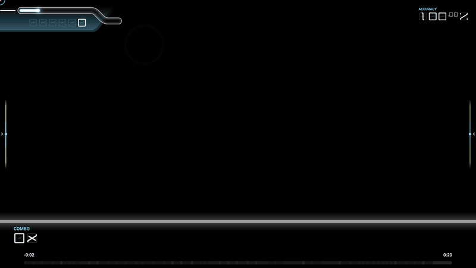
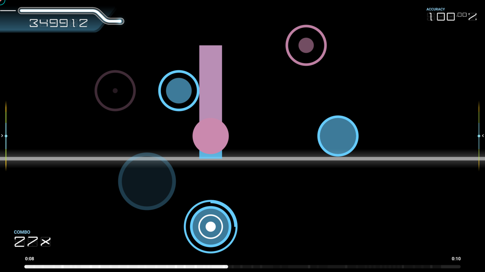
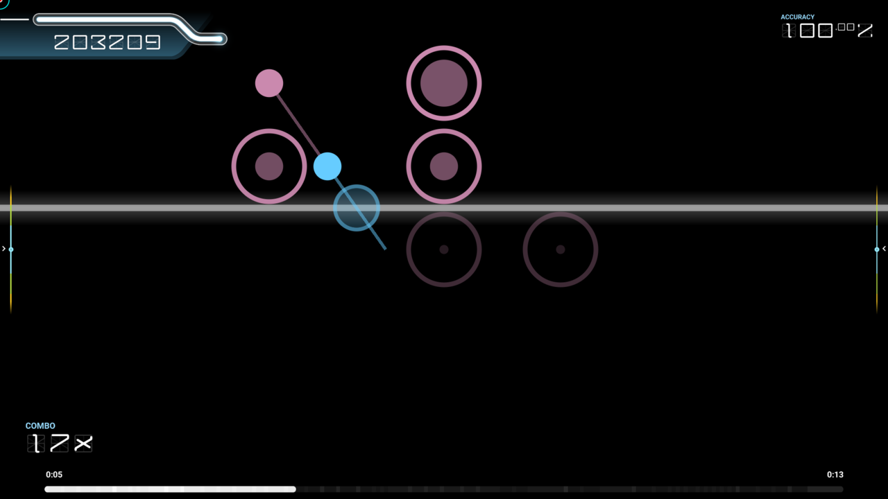
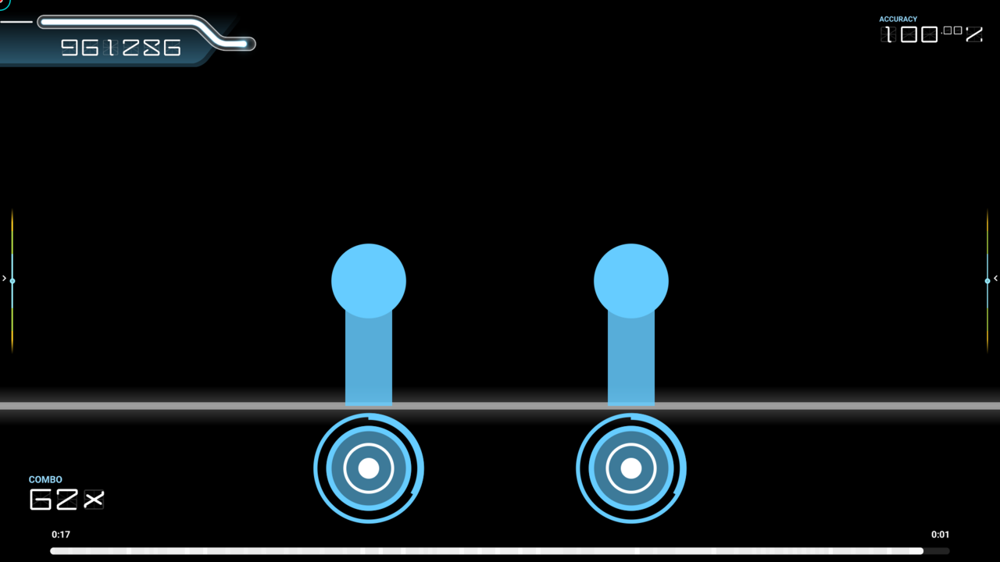

# osu!breve

*follow the scan line. to the measure.*

osu!breve is a ruleset for [osu!](https://osu.ppy.sh) inspired by Cytus. A scan line sweeps up and down the screen in time with the music, and you hit each note as the line crosses it.



*Autoplay on a short showcase beatmap. [Watch it in 1080p at 60 fps.](media/showcase.mp4)*

It has no beatmaps of its own. Every osu! beatmap you have can be played in osu!breve, converted from the music's timing and the beatmap's notes. Each sweep of the scan line lasts a beat, half a measure, or a whole number of measures, depending on the song's tempo, so the line always turns around on the beat. Notes stay roughly where the mapper put them, left to right, in one of nine lanes.

## Notes

- **Tap:** hit it as the scan line crosses it.
- **Hold:** the round note with a white ring and dot. Press it as the line arrives and keep holding until the line reaches the end of its trail. Long holds carry on across several sweeps.
- **Zigzag:** two taps in quick succession, the second one swinging far across the playfield from the first.
- **Drag chain:** a line of small linked nodes. Keep holding and follow the nodes as the line passes over them. On a keyboard, slide across the lane keys like a glissando.
- **Double:** two notes to hit at the same time, on the beatmap's accents.

|  |  |  |
|:---:|:---:|:---:|
| A long hold, with taps on either side | A drag chain | A double hold |

Notes for the line's next sweep show up early, greyed out, so you can read ahead.

By default you play the **Normal** chart. The **Expert** mod (EX) gives each beatmap a harder chart, with a zigzag for every run of short sliders. Both have their own star rating.

## Controls

| | |
|---|---|
| **Touch** | Tap the notes. Multi-touch works for doubles and holds. |
| **Keyboard** | One key per lane, by position: `A` `S` `D` `F` `Space` `J` `K` `L` `;` on a QWERTY keyboard, which is `Q` `S` `D` `F` `Space` `J` `K` `L` `M` on AZERTY. |
| **MIDI** | The white keys from middle C (C4) to D5, one per lane. |
| **Mouse** | Point at a note and click either button. |

Keyboard and MIDI bindings can be changed in osu!'s settings, under osu!breve's key bindings.

## Installing

1. Download `osu.Game.Rulesets.Breve.dll` from the [latest release](../../releases/latest).
2. In osu!, open the settings, and under **General**, then **Installation**, click **Open osu! folder**.
3. Put the DLL in the `rulesets` folder there.
4. Restart osu!. osu!breve shows up with the other rulesets in the toolbar.

This works with osu! on Windows, macOS and Linux. osu! on iOS and Android can't load rulesets from files: playing there means building osu! from source with osu!breve included.

Each release says which osu! release it was built against. osu! refuses rulesets built for an older ruleset API, so after some osu! updates osu!breve stops loading until a new release of it is built.

## Building

You need the [.NET 10 SDK](https://dotnet.microsoft.com/download).

```sh
dotnet build                      # builds the ruleset, its tests and the showcase
dotnet test                       # runs the tests
dotnet run --project osu.Game.Rulesets.Breve.Tests   # opens osu!'s test browser, to play the test scenes
```

The DLL is built to `osu.Game.Rulesets.Breve/bin/Debug/net10.0/`.

osu!breve is built against the osu! release set by `OsuVersion` in [Directory.Build.props](Directory.Build.props). It follows osu!'s code style and analysis rules, from osu!'s [.editorconfig](.editorconfig) and [CodeAnalysis](CodeAnalysis) folder.

### Remaking the media

The GIF, video and screenshots in [media](media) are made by [scripts/make-media.sh](scripts/make-media.sh). It plays a short showcase beatmap with autoplay in a window, captures every frame at 60 fps, and turns the frames into the video, the GIF and the screenshots. Run it again after changing how osu!breve looks. It takes about two minutes, and needs [ffmpeg](https://ffmpeg.org) and [ImageMagick](https://imagemagick.org).

The showcase beatmap and the capture are in [osu.Game.Rulesets.Breve.Showcase](osu.Game.Rulesets.Breve.Showcase). To check a change without remaking everything, capture a stretch of it, with times in milliseconds:

```sh
dotnet run --project osu.Game.Rulesets.Breve.Showcase -- frames 7000 8000
```

## Releasing

Push a tag named after the version, such as `v2026.1031.0`. The [release workflow](.github/workflows/release.yml) runs the tests, builds the DLL with that version, and publishes it as a GitHub release for the tag. If you make the release on GitHub's website instead, the workflow adds the DLL to it.

## License

osu!breve is released under the [MIT License](LICENSE).

The `.editorconfig`, `app.manifest` and `CodeAnalysis` files are adapted from [osu!](https://github.com/ppy/osu), copyright (c) ppy Pty Ltd, also under the MIT License.
