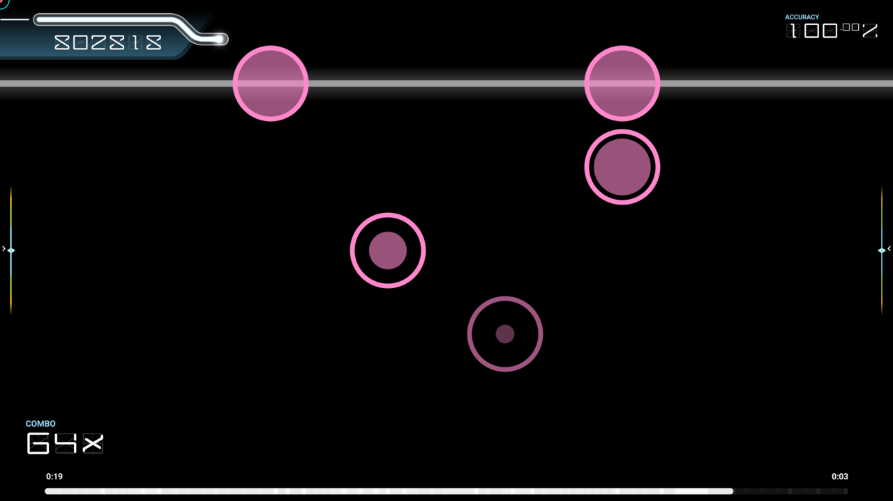
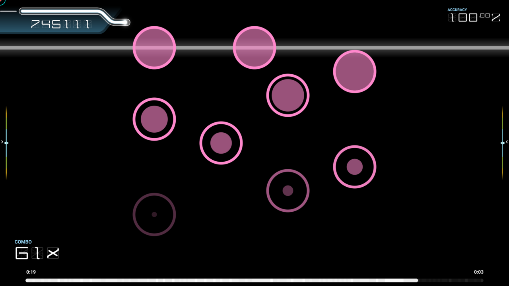
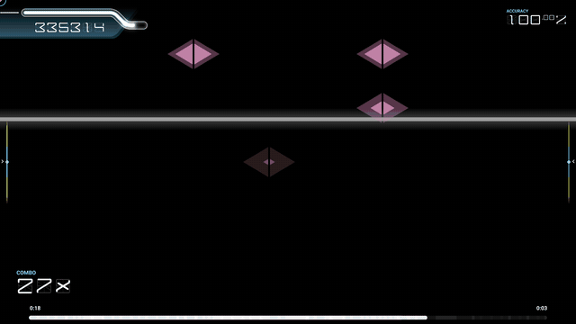
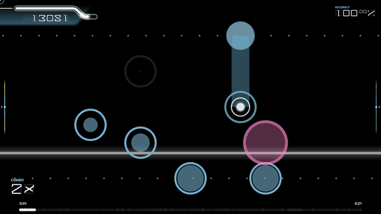

# osu!breve

*follow the scan line. to the measure.*

osu!breve is a ruleset for [osu!](https://osu.ppy.sh) inspired by Cytus. A scan line sweeps up and down the screen in time with the music, and you hit each note as the line crosses it.

*Autoplay on a short showcase beatmap. [Watch it in 1080p at 60 fps.](media/showcase.mp4)*

It has no beatmaps of its own. Every osu! beatmap you have can be played in osu!breve, converted from the music's timing and the beatmap's notes. Each sweep of the scan line lasts a beat, half a measure, or a whole number of measures, depending on the song's tempo, so the line always turns around on the beat. Notes stay roughly where the mapper put them, left to right, in one of nine lanes.

## Notes

- **Tap:** hit it as the scan line crosses it.
- **Hold:** the round note with a white ring and dot. Press it as the line arrives and keep holding until the line reaches the end of its trail. Long holds carry on across several sweeps.
- **Zigzag:** two taps in quick succession, the second one swinging far across the playfield from the first.
- **Drag chain:** a line of small linked nodes. Keep holding and follow the nodes as the line passes over them. On a keyboard, slide across the lane keys like a glissando.
- **Double:** two taps, holds or flicks to hit at the same time, on the beatmap's accents.
- **Flick:** a diamond between two lanes, with the Flicks mod. Move quickly across it from one lane to the other as the line passes: slide a finger across it, press one lane key just after the other, or click it and drag sideways.

|  |  |  |
|:---:|:---:|:---:|
| A long hold, with taps on either side | A drag chain | A double hold |

Notes for the line's next sweep show up early, greyed out, so you can read ahead.

## Mods

### Expert (EX)

By default you play each beatmap's **Normal** chart. Expert gives it a harder chart instead: sliders from half a beat long zigzag across the playfield, not only those of about a beat, so every run of short sliders swings from side to side. Each chart has its own star rating.

|  |  |
|:---:|:---:|
| Normal | Expert, at the same moment |

### Flicks (FK)

Turns short sliders into flicks: those under a beat, or under half a beat with Expert, where the longer ones are zigzags. Accented ones become double flicks.

*[Watch it in 1080p at 60 fps.](media/mod-flicks.mp4)*

### Border Lines (BL)

Shows dotted lines across the screen where the scan line turns around, as in Cytus II. The dots drift with the music, and each line bumps as the scan line turns on it.

*[Watch it in 1080p at 60 fps.](media/mod-border-lines.mp4)*

osu!breve also has osu!'s No Fail, Half Time, Double Time and Autoplay mods.

## Controls

| | |
|---|---|
| **Touch** | Tap the notes. Multi-touch works for doubles and holds. |
| **Keyboard** | One key per lane, by position: `A` `S` `D` `F` `Space` `J` `K` `L` `;` on a QWERTY keyboard, which is `Q` `S` `D` `F` `Space` `J` `K` `L` `M` on AZERTY. |
| **MIDI** | The white keys from middle C (C4) to D5, one per lane. |
| **Mouse** | Point at a note and click either button. |

Keyboard and MIDI bindings can be changed in osu!'s settings, under osu!breve's key bindings.

## Installing

1. Download `osu.Game.Rulesets.Breve.dll` from the [latest release](../../releases/latest).
2. In osu!, open the settings, and under **General**, then **Installation**, click **Open osu! folder**.
3. Put the DLL in the `rulesets` folder there.
4. Restart osu!. osu!breve shows up with the other rulesets in the toolbar.

This works with osu! on Windows, macOS and Linux. osu! on iOS and Android can't load rulesets from files: playing there means building osu! from source with osu!breve included (see [CONTRIBUTING.md](CONTRIBUTING.md#playing-on-ios-and-android)).

Each release says which osu! release it was built against. osu! refuses rulesets built for an older ruleset API, so after some osu! updates osu!breve stops loading until a new release of it is built.

## Contributing

To build osu!breve, run its tests, or find your way around its code, see [CONTRIBUTING.md](CONTRIBUTING.md).

## License

osu!breve is released under the [MIT License](LICENSE).

The `.editorconfig`, `app.manifest` and `CodeAnalysis` files are adapted from [osu!](https://github.com/ppy/osu), copyright (c) ppy Pty Ltd, also under the MIT License.
